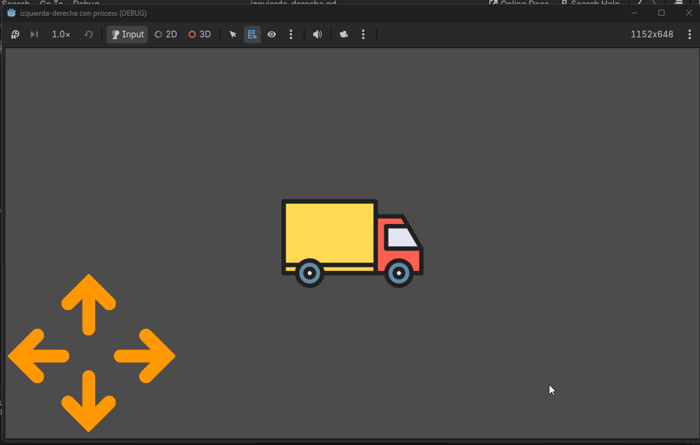
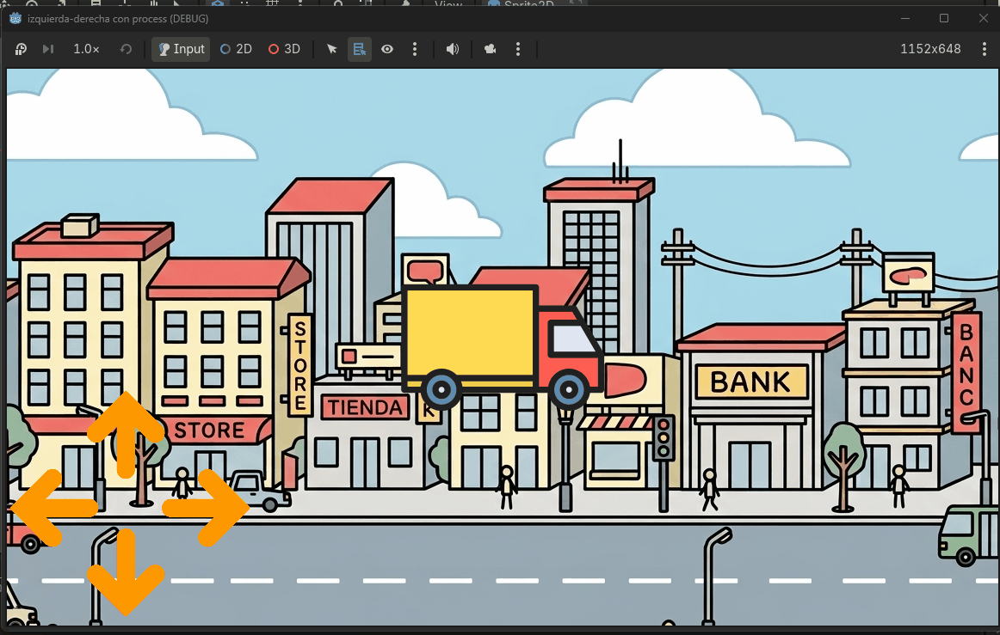

# Movimiento fluido

## Introducción

Vamos a partir del [proyecto de este enlace](izquierda-derecha-con-process.zip). Este fichero tendrás que descomprimirlo para continuar.

Ese fichero una solución parcial del proyecto que hicimos en la sesión anterior donde teníamos dos flechas y un objeto que se mueve. Aquí teníamos un problema: había que pulsar continuamente el botón para generar el evento `pressed` y así poder mover el objeto. Vamos a conseguir más fluidez utilizando el evento `_process(delta)`.

[Sigue la presentación que tienes aquí.](https://docs.google.com/presentation/d/1RphuF4_L5pm16JZFtnwZJ8jihvdfoBzzaCgscg2moaw/edit?usp=sharing)

Al final deberías tener un objeto que puedes mover de forma fluida hacia la izquierda y hacia la derecha.

Si no te salen los pasos puedes descargarte este [proyecto donde los pasos de la presentación están correctamente ejecutados](izquierda-derecha-con-process-inicio-practica.zip).

## ¿Qué tengo que hacer?

Tienes que poner dos flechas más:

- Una hacia arriba
- Otra hacia abajo

Las tienes que girar tú: busca cómo hacerlo y coloca los ficheros resultantes en la carpeta del proyecto de godot.

Coloca las flechas con un tamaño y con una posición más correcta para que simulen el control de un videojuego.

- Asígnale a la flecha hacia arriba la propiedad `Action` como `ui_up`.
- Asígnale a la flecha hacia abajo la propiedad `Action` como `ui_down`.

Modifica el programa para que podamos controlar la imagen en las dos dimensiones: horizontal y vertical.ç

Puedes modificar las imágenes si quieres. 



## Vamos a mejorarlo

Podemos hacer que la imagen mire se haga espejo en horizontal ejecutando esta orden:

```gdscript hl_lines="4 9" linenums="1"
	# Comprobar si la acción 'ui_left' está activa
    if Input.is_action_pressed("ui_left"):
		sprite_2d.position.x -= velocidad * delta
		sprite_2d.flip_h = true
	
	# Comprobar si la acción 'ui_right' está activa
	if Input.is_action_pressed("ui_right"):
		sprite_2d.position.x += velocidad * delta
		sprite_2d.flip_h = false
```

También, podemos añadir un nuevo nodo `Sprite2D` como primer hijo del elemento `Node2D`. Este nuevo sprite puede llamarse `Fondo` y le podemos poner una imagen en la propiedad `Texture` (como ya hicimos cuando pusimos la cara del robot) que sea un fondo. Puedes generar la imagen con 1152 x 648 píxeles con una IA y colocarla en la posición `X = 576, Y = 324` de forma que quede centrada y obtener algo como lo siguiente.


